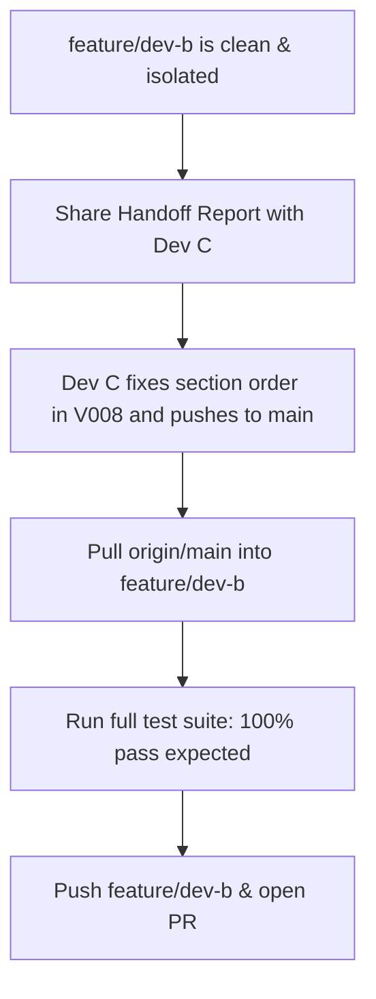

# Dev B Wave 2 Integration Handoff & Upstream Flagging Report

**Date:** 2026-10-03  
**Branch:** `feature/dev-b` (commit `af0a994`)  
**Base:** `ebfbd53` (Mid wave 1 transfer)  
**Remote Target:** `origin/main` (`e5c01c0`)  

---

## 1. Executive Summary

| Category | Status | Details |
| :--- | :--- | :--- |
| **Dev B Scope Boundary** | **100% Compliant** | Strictly touches 19 files in Dev B's People domain (`model`, `dao/people`, `service/people`, `controller`, and `test/.../people`). No external files modified or committed. |
| **Git Push Status** | **Unpushed (Local Only)** | All 5 Dev B commits (`451b0a4`..`af0a994`) reside strictly on the local `feature/dev-b` branch. |
| **Dev B Test Suite** | **40 / 40 Passing** | All People DAOs, Services, Controllers, and PostgreSQL feature tests pass. |
| **Git Merge Compatibility** | **0 Text Conflicts** | Clean merge with `origin/main`. 0 overlapping files between Dev B (19 files) and `origin/main` (80 files). |
| **Dev A Test Conflict** | **Resolved on Remote** | Dev A refactored `CorePlatformIntegrationTest` in commit `5f56e73` to accept non-fragile migration versions. |
| **Dev C Remote Migration** | **FLAGGED / BLOCKER** | `V008__development_seed.sql` on `origin/main` fails on fresh databases due to a foreign-key constraint ordering violation. |

---

## 2. Dev B Deliverables Verification

All Dev B work is contained within 5 local commits on `feature/dev-b`:

1. `451b0a4` `feat(people): add Person base model; refactor Volunteer and AffectedPerson to extend Person`
2. `5012abc` `feat(people): add VolunteerDao, AffectedPersonDao, VolunteerShiftDao`
3. `dba993c` `feat(people): add VolunteerService, AffectedPersonService, VolunteerShiftService`
4. `b3a2ff2` `feat(people): wire VolunteerController, AffectedPersonController, VolunteerShiftController to services`
5. `af0a994` `test(people): add 40 integration tests for people DAOs, services, and PostgreSQL features`

### Test Suite Execution on `feature/dev-b`
```text
Total tests executed: 49
Passed: 48
Failed: 1 (CorePlatformIntegrationTest > freshDatabaseContainsTheCompleteV001ToV003Contract)
Dev B People Tests: 40/40 PASSED (100%)
```

---

## 3. Remote Integration & Conflict Analysis (`origin/main`)

`origin/main` is 2 commits ahead of the branch point (`ebfbd53`):
* `5f56e73`: `feat: complete Dev A wave 2 core integration` (Dev A)
* `e5c01c0`: `dev 3 wave 2 & 3` (Dev C)

### A. Git File Collisions
* Files modified on `feature/dev-b`: 19
* Files modified on `origin/main`: 80
* Overlapping files: **0**
* `git merge-tree --write-tree HEAD origin/main`: Exited cleanly (`56a713e...`) with **zero merge conflicts**.

### B. Dev A Test Conflict Status: RESOLVED
In Wave 1, `CorePlatformIntegrationTest` failed because it asserted an exact count of 3 migrations (`expected: <3> but was: <4>`).

In commit `5f56e73`, Dev A updated [CorePlatformIntegrationTest.java](file:///home/vidyasree/disaster-relief-allocation-system/src/test/java/com/groupa13/disasterrelief/core/CorePlatformIntegrationTest.java):
```java
// Dev A updated migration verification:
assertEquals(
        Set.of("001", "002", "003"),
        querySet("""
                SELECT version
                FROM flyway_schema_history
                WHERE success AND version IN ('001', '002', '003')
                """));

// Dev A updated table verification to subset check:
assertTrue(querySet("""
        SELECT table_name
        FROM information_schema.tables
        WHERE table_schema = 'public'
          AND table_type = 'BASE TABLE'
        """).containsAll(Set.of(
                "disasters", "zones", "shelters",
                "resource_categories", "resources", "shelter_inventory")));
```
**Conclusion:** Dev A's test will no longer conflict with `V004__people_schema.sql` or subsequent migrations.

---

## 4. Flagged Upstream Issue: Dev C Migration Ordering in `V008`

> [!CAUTION]
> **Upstream Blocker on `origin/main`:**  
> When running migrations against a fresh database, Flyway fails executing [V008__development_seed.sql](file:///home/vidyasree/disaster-relief-allocation-system/database/migrations/V008__development_seed.sql).

### Error Details
```text
org.postgresql.util.PSQLException: ERROR: insert or update on table "app_users" violates foreign key constraint "fk_app_users_assigned_zone"
  Detail: Key (assigned_zone_id)=(1) is not present in table "zones".
Location   : database/migrations/V008__development_seed.sql
Line       : 25
```

### Root Cause
In [database/migrations/V008__development_seed.sql](file:///home/vidyasree/disaster-relief-allocation-system/database/migrations/V008__development_seed.sql):
* **Section 2 (Lines 25–32):** Inserts `app_users`, including:
  ```sql
  (2, 102, 'zone_coord', '...', 'ZONE_COORDINATOR', 1, true)
  ```
  This record references `assigned_zone_id = 1`.
* **Section 3 (Lines 40–56):** Inserts the initial `disasters`, `shelters`, and `zones` (including `zone_id = 1`).
* **The Failure:** `zones` does not yet contain `zone_id = 1` when Section 2 executes. On any fresh database or clean test container, the foreign key constraint `fk_app_users_assigned_zone` fails immediately.

### Why Dev C Did Not Catch It
Dev C's test suite ([OperationsValidationTest.java](file:///home/vidyasree/disaster-relief-allocation-system/src/test/java/com/groupa13/disasterrelief/operations/OperationsValidationTest.java) and [PasswordHasherTest.java](file:///home/vidyasree/disaster-relief-allocation-system/src/test/java/com/groupa13/disasterrelief/operations/PasswordHasherTest.java)) only ran mock/unit tests without launching a PostgreSQL Testcontainer or running Flyway migrations.

### Required Fix (For Dev C)
In `database/migrations/V008__development_seed.sql`, move **Section 3 (Seed Base Operational Entities: disasters, shelters, zones)** *before* **Section 2 (Seed Demonstration App Users)**.

---

## 5. Dev C Schema Interactions with Dev B
Dev C added operations and security integrations that interact with Dev B's tables:
1. **Triggers:** `trg_audit_volunteers`, `trg_audit_affected_persons`, and `trg_audit_volunteer_shifts` in `V006`.
2. **Foreign Keys:** `app_users (person_id)` references `people (person_id)` in `V007`.
3. **Row-Level Security:** RLS enabled on `affected_persons` in `V007`. Policies allow access when `app.current_zone_id` is null or matches the shelter's zone.
4. **View:** `v_volunteer_availability` in `V007` joins `volunteers`, `people`, `volunteer_shifts`, and `zones`.

All of these definitions match the schema contracts established in `V004__people_schema.sql`.

---

## 6. Recommended Action Plan



1. **Keep `feature/dev-b` clean:** Do not commit changes to `V008` on Dev B's branch.
2. **Flag to Dev C:** Provide the error stack trace and the 10-line section reorder needed in `V008__development_seed.sql`.
3. **Merge & Validate:** Once Dev C pushes the fix to `main`, merge `origin/main` into `feature/dev-b` and verify that the full test suite passes.
