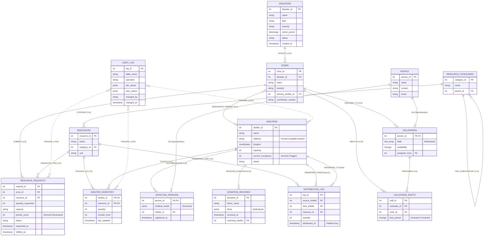

# Section 3.2 — Entity-Relationship (ER) Diagram & Specification

**Project:** Disaster Relief Resource Allocation System (DRRAS)  
**Course:** 23CSE202 — Database Management Systems  
**Institution:** Amrita School of Computing  
**Group:** A13 — Hrishinandan Namboothiry U, Vidyasree Jayaprasad, Adithya Narayanan S  

---

## 1. ER Modeling Notation & Standards

This document presents the complete conceptual Entity-Relationship (ER) model for the DRRAS database. It adheres to standard academic ER modeling guidelines (Peter Chen notation principles & Crow's Foot ER representations), resolving all inconsistencies present in early design drafts.

### Academic Notation Legend

| Symbol / Style | ER Construct | Meaning in DRRAS |
|---|---|---|
| **Single Rectangle** | Strong Entity | An entity with its own independent existence and primary key (e.g., `DISASTERS`, `SHELTERS`). |
| **Double Rectangle** | Weak Entity / Associative Entity | An entity whose existence depends on one or more owner entities (e.g., `SHELTER_INVENTORY`). |
| **Diamond** | Relationship | Associates two or more entities (e.g., `AFFECTS`, `CONTAINS`, `CREATES`). |
| **Double Diamond** | Identifying Relationship | Links a weak/associative entity to its identifying owner entity. |
| **Triangle / Hexagon (ISA)** | Generalization / Specialization | Superclass–subclass relationship with inheritance (`PEOPLE` $\to$ `VOLUNTEERS`, `AFFECTED_PERSONS`). |
| **Underlined Attribute** | Primary Key | Uniquely identifies an entity instance (e.g., <u>`disaster_id`</u>). |
| **Double Ellipse / `{}`** | Multivalued Attribute | Can take multiple values for a single entity instance (e.g., `{skills}`). |
| **Dashed Ellipse / `°`** | Derived Attribute | Value is computed from other attributes or tables (e.g., `occupancy°`, `priority_score°`). |
| **Divided Ellipse** | Composite Attribute | Attribute composed of sub-attributes (e.g., `location(latitude, longitude)`). |
| **Double Line / `(1, 1)` or `(1, N)`** | Total Participation | Every entity instance must participate in the relationship (mandatory). |
| **Single Line / `(0, 1)` or `(0, N)`** | Partial Participation | Entity instances may optionally participate in the relationship (optional). |

> [!IMPORTANT]
> **Conceptual Cleanliness Rule:** In pure conceptual ER modeling, **Foreign Keys (FKs) do not appear as attributes** inside entity boxes. Relationships and participation lines define the connections. Foreign keys only appear later during the **Relational Mapping (Section 3.3)**.

---

## 2. Complete Entity Specification

### 2.1 Strong Entities

#### 1. `DISASTERS`
* **Description:** Represents an overarching natural disaster event (flood, cyclone, landslide, etc.).
* **Attributes:**
  * <u>`disaster_id`</u> (Primary Key, Simple, Single-valued)
  * `name` (Simple, Single-valued, Mandatory)
  * `type` (Simple, Single-valued, Optional — flood, earthquake, cyclone)
  * `severity` (Simple, Single-valued, Mandatory — low, medium, high, critical)
  * `active_period` (Range/Composite: `start_date`, `end_date`)
  * `status` (Simple, Single-valued, Mandatory — active, monitoring, resolved, closed)
  * `created_at` (Simple, Single-valued)

#### 2. `ZONES`
* **Description:** Distinct geographic sectors demarcated within an active disaster perimeter.
* **Attributes:**
  * <u>`zone_id`</u> (Primary Key, Simple, Single-valued)
  * `name` (Simple, Single-valued, Mandatory)
  * `severity` (Simple, Single-valued, Mandatory — low, medium, high, critical)
  * `coordinator_contact` (Simple, Single-valued, Optional)

#### 3. `SHELTERS`
* **Description:** Physical relief camps, schools, or community centres providing refuge and stocking supplies.
* **Attributes:**
  * <u>`shelter_id`</u> (Primary Key, Simple, Single-valued)
  * `name` (Simple, Single-valued, Mandatory)
  * `address` (Simple, Single-valued, Optional — physical human-readable location)
  * `location` (Composite Attribute: composed of `latitude` and `longitude`)
  * `capacity` (Simple, Single-valued, Mandatory, Integer > 0)
  * `current_occupancy°` (**Derived Attribute**, maintained by trigger from `AFFECTED_PERSONS`)
  * `status` (Simple, Single-valued, Mandatory — operational, full, closed)

#### 4. `RESOURCE_CATEGORIES`
* **Description:** Hierarchical taxonomy classifying relief goods.
* **Attributes:**
  * <u>`category_id`</u> (Primary Key, Simple, Single-valued)
  * `name` (Simple, Single-valued, Mandatory)

#### 5. `RESOURCES`
* **Description:** Master item catalog defining distinct types of relief supplies.
* **Attributes:**
  * <u>`resource_id`</u> (Primary Key, Simple, Single-valued)
  * `name` (Simple, Single-valued, Mandatory)
  * `unit` (Simple, Single-valued, Optional — packets, litres, kg, pieces)

#### 6. `PEOPLE` (Superclass)
* **Description:** Generalized entity representing any human actor interacting with the relief system.
* **Attributes:**
  * <u>`person_id`</u> (Primary Key, Simple, Single-valued)
  * `name` (Simple, Single-valued, Mandatory)
  * `contact` (Simple, Single-valued, Optional)
  * `email` (Simple, Single-valued, Optional)

#### 7. `RESOURCE_REQUESTS`
* **Description:** Formal requisition submitted by a zone coordinator for urgent supplies.
* **Attributes:**
  * <u>`request_id`</u> (Primary Key, Simple, Single-valued)
  * `quantity_requested` (Simple, Single-valued, Mandatory, Integer > 0)
  * `urgency` (Simple, Single-valued, Mandatory — critical, high, medium, low)
  * `priority_score°` (**Derived Attribute**, auto-computed by PostgreSQL generated expression)
  * `status` (Simple, Single-valued, Mandatory — pending, fulfilled, cancelled)
  * `requested_at` (Simple, Single-valued, Timestamp)
  * `fulfilled_at` (Simple, Single-valued, Timestamp, Optional)

#### 8. `VOLUNTEER_SHIFTS`
* **Description:** Scheduled deployment of a volunteer to an operational zone for a specific time window.
* **Attributes:**
  * <u>`shift_id`</u> (Primary Key, Simple, Single-valued)
  * `duty_period` (Range/Composite: `start_time`, `end_time` with non-overlapping exclusion constraint)

#### 9. `DISTRIBUTION_LOG`
* **Description:** Append-only transactional log recording inter-shelter resource transfers.
* **Attributes:**
  * <u>`log_id`</u> (Primary Key, Simple, Single-valued)
  * `quantity` (Simple, Single-valued, Mandatory, Integer > 0)
  * `distributed_at` (Simple, Single-valued, Partition Key)

#### 10. `DONATION_RECORDS`
* **Description:** Intake document recording donated relief supplies received from external donors.
* **Attributes:**
  * <u>`donation_id`</u> (Primary Key, Simple, Single-valued)
  * `donor_name` (Simple, Single-valued, Optional)
  * `{items}` (**Multivalued / Structured Attribute**, array of resource-quantity pairs)
  * `received_at` (Simple, Single-valued, Timestamp)

#### 11. `AUDIT_LOG`
* **Description:** System-level immutable audit tracking every data mutation across tables.
* **Attributes:**
  * <u>`log_id`</u> (Primary Key, Simple, Single-valued)
  * `table_name` (Simple, Single-valued, Mandatory)
  * `operation` (Simple, Single-valued, Mandatory — INSERT, UPDATE, DELETE)
  * `old_values` (JSON snapshot, Optional)
  * `new_values` (JSON snapshot, Optional)
  * `changed_by` (Simple, Single-valued, Optional)
  * `changed_at` (Simple, Single-valued, Timestamp)

---

### 2.2 Specialization / Subclass Entities (ISA Hierarchy)

The `PEOPLE` superclass specializes into two disjoint subclasses:

```
                  PEOPLE
                    |
               [ d, partial ]  (Disjoint, Partial Specialization)
               /            \
              /              \
        VOLUNTEERS      AFFECTED_PERSONS
```

* **Specialization Constraints:**
  * **Disjoint ($d$):** A person cannot simultaneously be registered as a displaced victim and an active operational volunteer.
  * **Partial:** A person can exist in the system (e.g., administrative staff or donor contact) without belonging to either subclass.

#### 1. `VOLUNTEERS` (Subclass of `PEOPLE`)
* **Inherits:** `person_id`, `name`, `contact`, `email` from `PEOPLE`.
* **Specific Attributes:**
  * `{skills}` (**Multivalued Attribute**, array of skill tags, e.g., first aid, driving, cooking)
  * `availability` (Range/Composite: available time window)

#### 2. `AFFECTED_PERSONS` (Subclass of `PEOPLE`)
* **Inherits:** `person_id`, `name`, `contact`, `email` from `PEOPLE`.
* **Specific Attributes:**
  * `medical_needs` (Structured/Composite Attribute, specific health/disability requirements)
  * `registered_at` (Simple, Single-valued, Timestamp)

---

### 2.3 Associative / Weak Entity

#### `SHELTER_INVENTORY`
* **Description:** Represents the inventory level of a specific resource stocked at a specific shelter. Resolves the M:N relationship between `SHELTERS` and `RESOURCES`.
* **Identifying Owners:** `SHELTERS` and `RESOURCES`.
* **Key Attributes:**
  * <u>`shelter_id`</u> (from `SHELTERS`) + <u>`resource_id`</u> (from `RESOURCES`) form the composite primary key.
* **Non-Key Attributes:**
  * `quantity` (Simple, Single-valued, Integer $\ge$ 0)
  * `reorder_level` (Simple, Single-valued, Integer threshold)
  * `last_updated` (Simple, Single-valued, Timestamp)

---

## 3. Structural Constraints: Cardinality & Participation Matrix

The following matrix documents every relationship in DRRAS, specifying its exact cardinality ratio and participation constraints (both Min/Max notation and Total/Partial semantics):

| Relationship Name | Participating Entities | Cardinality Ratio | Entity 1 Participation & (Min, Max) | Entity 2 Participation & (Min, Max) | Real-World Business Rule |
|:---|:---|:---:|:---|:---|:---|
| **`AFFECTS`** | `DISASTERS` — `ZONES` | **1 : N** | `DISASTERS`: Partial `(0, N)` | `ZONES`: **Total `(1, 1)`** | A disaster may affect zero or many zones; every zone must belong to exactly one disaster. |
| **`DESIGNATES_PRIMARY`** | `ZONES` — `SHELTERS` | **N : 1** | `ZONES`: Partial `(0, 1)` | `SHELTERS`: Partial `(0, N)` | A zone designates at most one primary shelter; a shelter may serve as primary for multiple zones or none. |
| **`ACCOMMODATES`** | `SHELTERS` — `AFFECTED_PERSONS` | **1 : N** | `SHELTERS`: Partial `(0, N)` | `AFFECTED_PERSONS`: Partial `(0, 1)` | A shelter accommodates many persons; a person is housed in at most one shelter at a time. |
| **`CONTAINS`** | `RESOURCE_CATEGORIES` — `RESOURCES` | **1 : N** | `RESOURCE_CATEGORIES`: Partial `(0, N)` | `RESOURCES`: **Total `(1, 1)`** | A category contains multiple items; every resource item must belong to exactly one category. |
| **`HAS_SUBCATEGORY`** | `RESOURCE_CATEGORIES` (Self-ref) | **1 : N** | Parent Category: Partial `(0, N)` | Child Category: Partial `(0, 1)` | Root categories have no parent; subcategories have at most one direct parent. |
| **`STOCKS` / `MAINTAINS`** | `SHELTERS` — `SHELTER_INVENTORY` | **1 : N** | `SHELTERS`: Partial `(0, N)` | `SHELTER_INVENTORY`: **Total `(1, 1)`** | A shelter can stock many inventory items; an inventory record must belong to a valid shelter. |
| **`STOCKED_AS`** | `RESOURCES` — `SHELTER_INVENTORY` | **1 : N** | `RESOURCES`: Partial `(0, N)` | `SHELTER_INVENTORY`: **Total `(1, 1)`** | A catalog resource can be stocked across many shelters; an inventory record must reference a valid catalog resource. |
| **`SUBMITS_REQUEST`** | `ZONES` — `RESOURCE_REQUESTS` | **1 : N** | `ZONES`: Partial `(0, N)` | `RESOURCE_REQUESTS`: **Total `(1, 1)`** | A zone may submit zero or more requests; every request must originate from an affected zone. |
| **`REQUESTS_ITEM`** | `RESOURCES` — `RESOURCE_REQUESTS` | **1 : N** | `RESOURCES`: Partial `(0, N)` | `RESOURCE_REQUESTS`: **Total `(1, 1)`** | A resource may be requested zero or more times; every request must be for exactly one resource. |
| **`ASSIGNED_TO_ZONE`** | `ZONES` — `VOLUNTEERS` | **1 : N** | `ZONES`: Partial `(0, N)` | `VOLUNTEERS`: Partial `(0, 1)` | A volunteer is assigned to at most one base zone at any given time. |
| **`PERFORMS_SHIFT`** | `VOLUNTEERS` — `VOLUNTEER_SHIFTS` | **1 : N** | `VOLUNTEERS`: Partial `(0, N)` | `VOLUNTEER_SHIFTS`: **Total `(1, 1)`** | A volunteer can take many shifts; every shift must be assigned to exactly one volunteer. |
| **`DEPLOYS_SHIFT`** | `ZONES` — `VOLUNTEER_SHIFTS` | **1 : N** | `ZONES`: Partial `(0, N)` | `VOLUNTEER_SHIFTS`: **Total `(1, 1)`** | A shift is deployed to exactly one zone. |
| **`TRANSFERS_FROM`** | `SHELTERS` — `DISTRIBUTION_LOG` | **1 : N** | `SHELTERS`: Partial `(0, N)` | `DISTRIBUTION_LOG`: **Total `(1, 1)`** | Every transfer must have a designated source shelter. |
| **`TRANSFERS_TO`** | `SHELTERS` — `DISTRIBUTION_LOG` | **1 : N** | `SHELTERS`: Partial `(0, N)` | `DISTRIBUTION_LOG`: **Total `(1, 1)`** | Every transfer must have a designated destination shelter. |
| **`TRANSFERS_ITEM`** | `RESOURCES` — `DISTRIBUTION_LOG` | **1 : N** | `RESOURCES`: Partial `(0, N)` | `DISTRIBUTION_LOG`: **Total `(1, 1)`** | Every distribution record moves a specific catalog item. |
| **`RECEIVES_DONATION`** | `SHELTERS` — `DONATION_RECORDS` | **1 : N** | `SHELTERS`: Partial `(0, N)` | `DONATION_RECORDS`: Partial `(0, 1)` | A donation can be accepted at a specific shelter (or recorded centrally). |
| **`AUDITED_BY`** | All Core Entities — `AUDIT_LOG` | **1 : N** | Core Entities: Partial `(0, N)` | `AUDIT_LOG`: **Total `(1, 1)`** | Database triggers (`trg_audit_log`) fire on INSERT/UPDATE/DELETE across critical tables to populate audit records. |

> [!NOTE]
> **Procedural vs. Structural Relationship Note (`DONATION_RECORDS` $\to$ `SHELTER_INVENTORY`):**
> There is intentionally **no direct relationship diamond / Foreign Key** drawn between `DONATION_RECORDS` and `SHELTER_INVENTORY`. In disaster relief operations, a single donation delivery typically contains multiple items (`items JSONB`). When processed, the database/application iterates over the donation items and executes procedural `UPSERT` operations directly on `SHELTER_INVENTORY`. Drawing an ER relationship line would incorrectly imply a direct foreign key column that does not exist.

---

## 4. Complete Mermaid ER Diagram

This standard Crow's Foot ER diagram accurately captures all entity attributes, keys, relationships, and cardinalities:



---

## 5. Visual Draw.io Model

A fully formatted, interactive Draw.io vector diagram is available in your repository at:  
👉 [`database/er-diagram/drras_er_diagram.drawio`](file:///c:/Users/adith/OneDrive/Desktop/CSE/S3/DBMS/disaster-relief-allocation-system/database/er-diagram/drras_er_diagram.drawio)

### How to Open & Edit:
1. Open your web browser and navigate to [app.diagrams.net](https://app.diagrams.net/).
2. Click **File $\to$ Open From $\to$ Device...**
3. Select `database/er-diagram/drras_er_diagram.drawio` from this repository.
4. You can make visual customizations, change color palettes, and directly export to high-resolution PNG or PDF for your project report.
